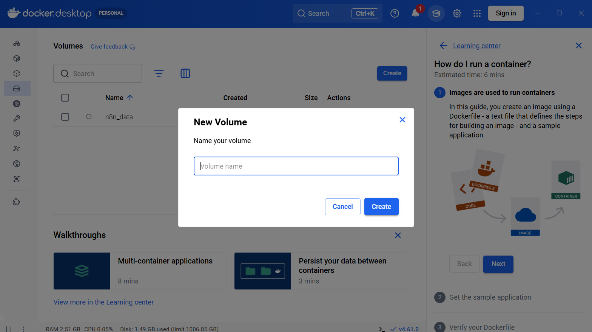
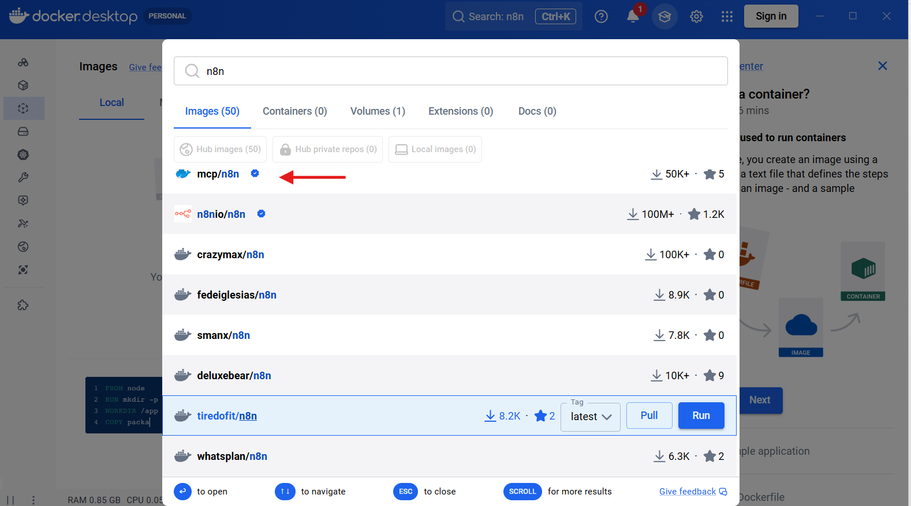
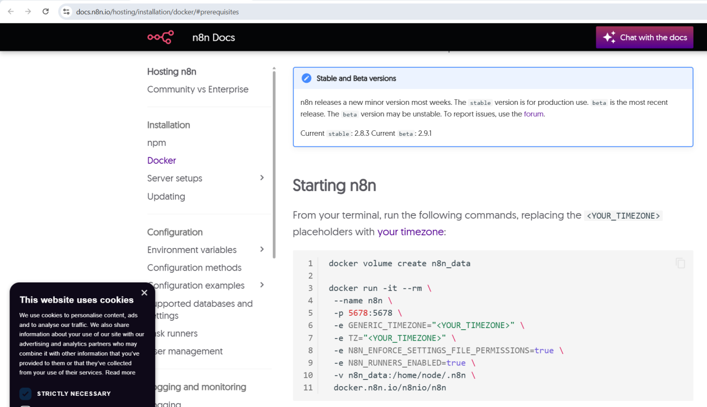
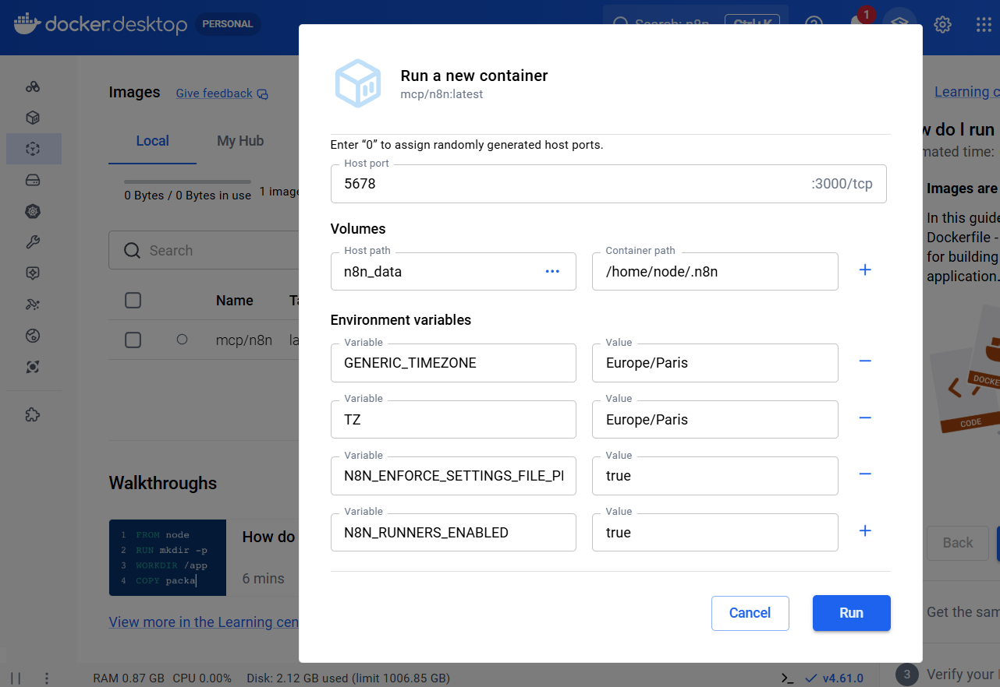
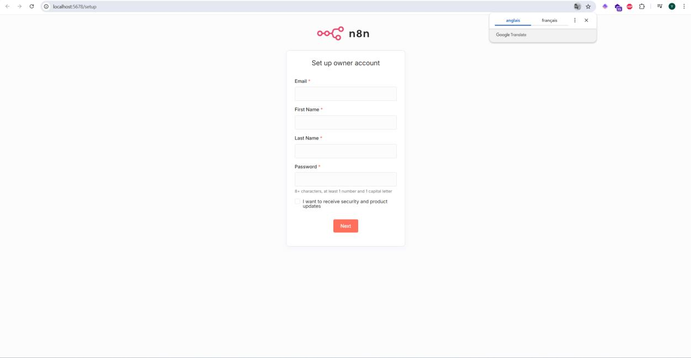
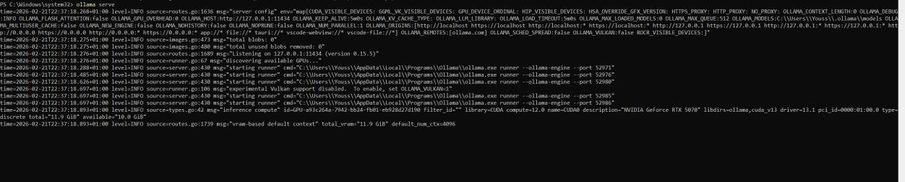
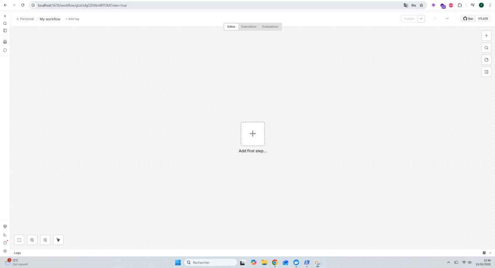
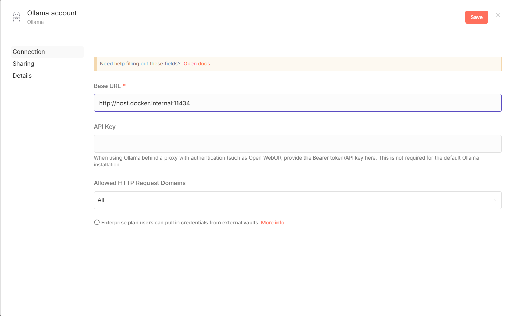
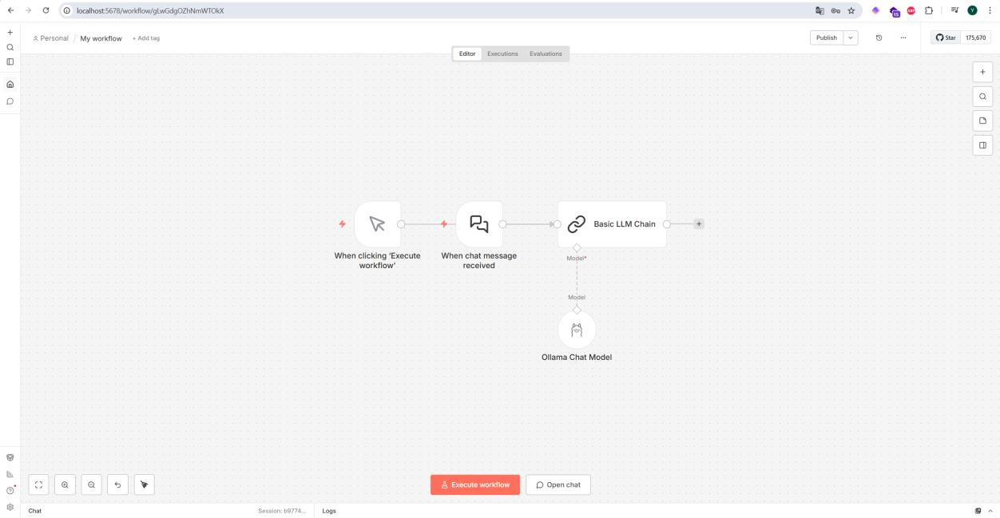

# 🤖 Connecting n8n to Ollama via Docker

<p align="center">
  <a href="README.md">English</a> &bull;
  <a href="README_fr.md">Français</a>
</p>

This guide explains how to install and configure **n8n** (automation tool) and **Ollama** (local LLM) so they work together.

> This is an illustrated guide, not a ready-to-deploy `docker-compose` stack.

---

## 📋 Prerequisites

- [Docker Desktop](https://www.docker.com/products/docker-desktop/) installed
- [Ollama](https://ollama.com/) installed
- PowerShell (Windows) or Terminal (Mac/Linux)

---

## 🐳 Step 1: Create a Docker volume

In Docker Desktop, go to **Volumes** and create a volume named:

```
n8n_data
```



---

## 📦 Step 2: Download the n8n image

In Docker Desktop, go to the **Images** tab, search for `n8n` and select the first result:

```
n8nio/n8n
```



---

## 🚀 Step 3: Run the n8n container

From the official n8n documentation, use the following commands in the terminal:

```bash
docker volume create n8n_data

docker run -it --rm \
  --name n8n \
  -p 5678:5678 \
  -e GENERIC_TIMEZONE="Europe/Paris" \
  -e TZ="Europe/Paris" \
  -e N8N_ENFORCE_SETTINGS_FILE_PERMISSIONS=true \
  -e N8N_RUNNERS_ENABLED=true \
  -v n8n_data:/home/node/.n8n \
  docker.n8n.io/n8nio/n8n
```

On **Docker Engine Linux**, also add the host alias to the `docker run` command:

```bash
--add-host=host.docker.internal:host-gateway
```



Or via the Docker Desktop interface with these settings:

| Setting | Value |
|---|---|
| Host port | `5678` |
| Host path (volume) | `n8n_data` |
| Container path | `/home/node/.n8n` |
| `GENERIC_TIMEZONE` | `Europe/Paris` |
| `TZ` | `Europe/Paris` |
| `N8N_ENFORCE_SETTINGS_FILE_PERMISSIONS` | `true` |
| `N8N_RUNNERS_ENABLED` | `true` |



---

## 🌐 Step 4: Access n8n

Once the container is running, open in the browser:

```
http://localhost:5678
```

Create an owner account to access the interface.



---

## 🧠 Step 5: Start Ollama

Download and install [Ollama](https://ollama.com/), then start the server in PowerShell:

```powershell
ollama serve
```

Ollama will serve as the language model (brain) for the n8n workflows.



---

## ⚙️ Step 6: Configure Ollama in n8n

In n8n, when creating a workflow, start by creating a new empty workflow.



Add an **Ollama Chat Model** node with the following configuration:

| Field | Value |
|---|---|
| Base URL | `http://host.docker.internal:11434` |
| API Key | *(leave empty for a standard Ollama install)* |

> ⚠️ The `host.docker.internal` URL lets the container reach Ollama on the host. On Docker Engine Linux, it generally requires the `--add-host=host.docker.internal:host-gateway` option shown above.



---

## 🔗 Step 7: Create the final workflow

The basic workflow to connect Ollama to n8n should look like this:

```
[When chat message received] → [Basic LLM Chain] → [Ollama Chat Model]
```

The nodes to add:
1. **When chat message received** (chat trigger)
2. **Basic LLM Chain** (LLM chain)
3. **Ollama Chat Model** (model connected to Ollama)



---

## 📚 Resources

- [n8n documentation - Docker installation](https://docs.n8n.io/hosting/installation/docker/)
- [Ollama](https://ollama.com/)
- [Docker Desktop](https://www.docker.com/products/docker-desktop/)
