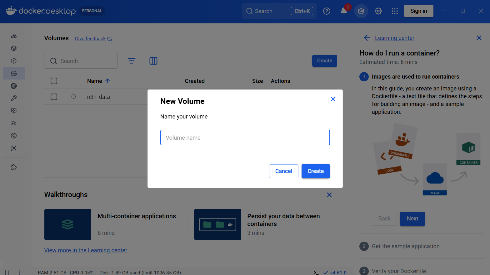
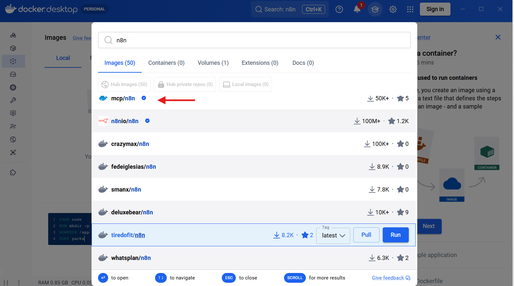
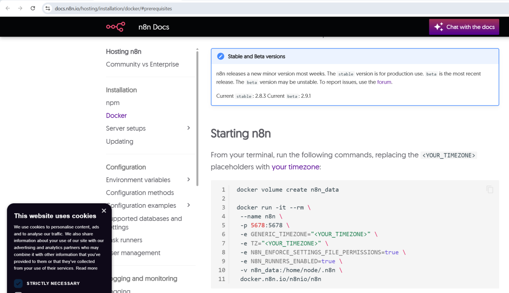
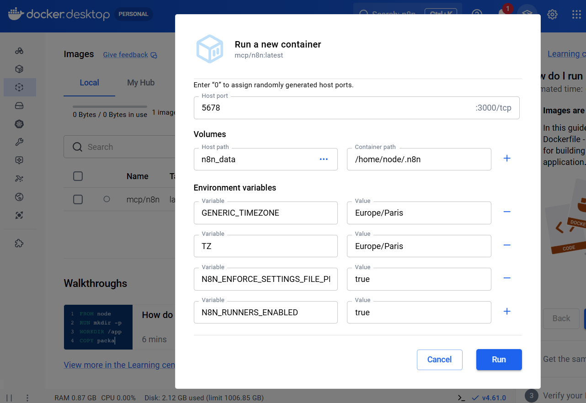
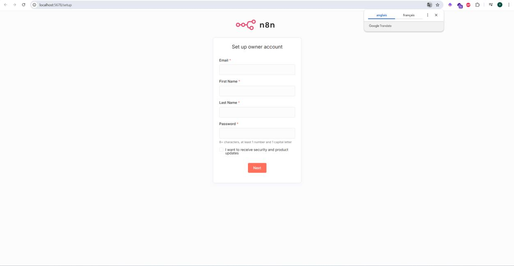
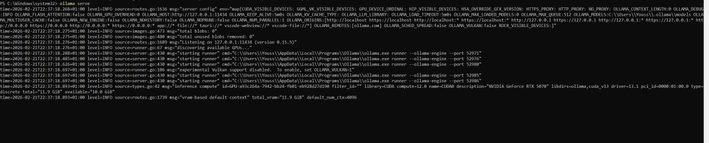
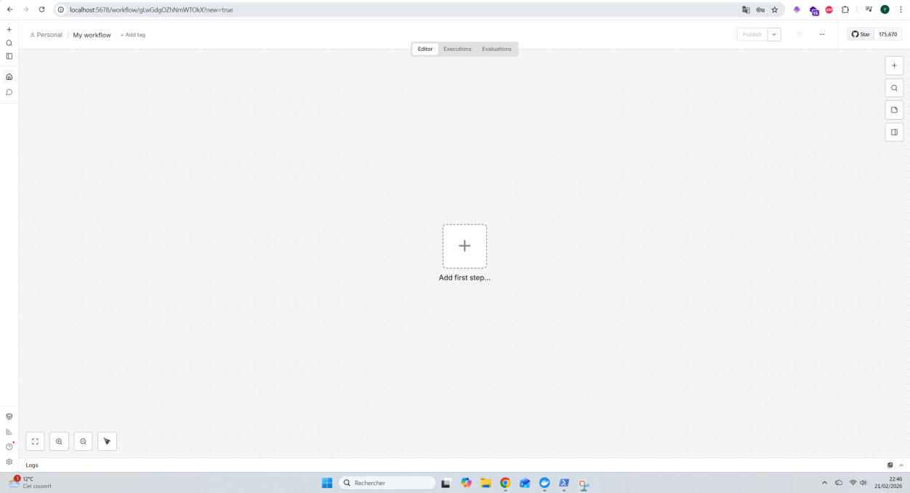
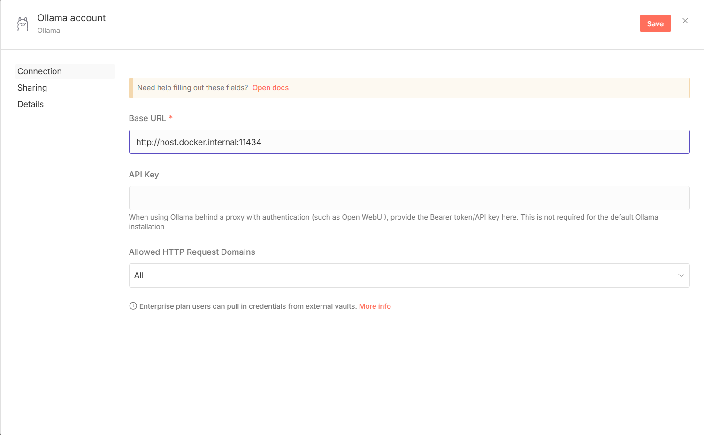
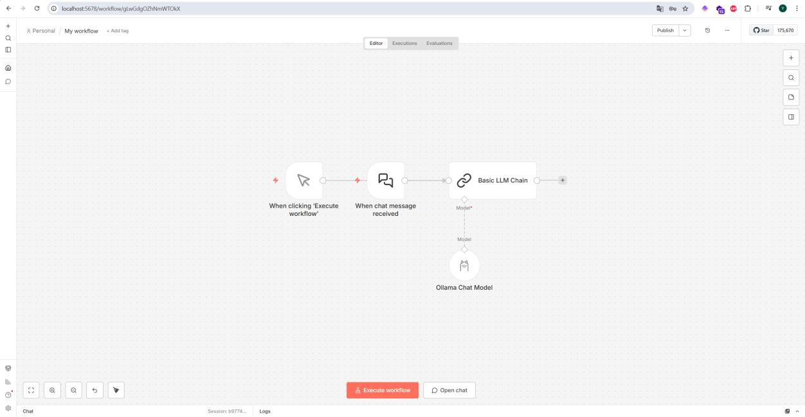

# 🤖 Connecter n8n à Ollama via Docker

<p align="center">
  <a href="README.md">English</a> &bull;
  <a href="README_fr.md">Français</a>
</p>

Ce guide explique comment installer et configurer **n8n** (outil d'automatisation) et **Ollama** (LLM local) pour les faire fonctionner ensemble.

> Il s'agit d'un guide illustré, pas d'une stack `docker-compose` prête à déployer.

---

## 📋 Prérequis

- [Docker Desktop](https://www.docker.com/products/docker-desktop/) installé
- [Ollama](https://ollama.com/) installé
- PowerShell (Windows) ou Terminal (Mac/Linux)

---

## 🐳 Étape 1 — Créer un volume Docker

Dans Docker Desktop, aller dans **Volumes** et créer un volume nommé :

```
n8n_data
```



---

## 📦 Étape 2 — Télécharger l'image n8n

Dans Docker Desktop, aller dans l'onglet **Images**, rechercher `n8n` et sélectionner le premier résultat :

```
n8nio/n8n
```



---

## 🚀 Étape 3 — Lancer le conteneur n8n

Depuis la documentation officielle n8n, utiliser les commandes suivantes dans le terminal :

```bash
docker volume create n8n_data

docker run -it --rm \
  --name n8n \
  -p 5678:5678 \
  -e GENERIC_TIMEZONE="Europe/Paris" \
  -e TZ="Europe/Paris" \
  -e N8N_ENFORCE_SETTINGS_FILE_PERMISSIONS=true \
  -e N8N_RUNNERS_ENABLED=true \
  -v n8n_data:/home/node/.n8n \
  docker.n8n.io/n8nio/n8n
```

Sur **Docker Engine Linux**, ajoutez également l'alias vers l'hôte à la commande `docker run` :

```bash
--add-host=host.docker.internal:host-gateway
```



Ou via l'interface Docker Desktop avec ces paramètres :

| Paramètre | Valeur |
|---|---|
| Host port | `5678` |
| Host path (volume) | `n8n_data` |
| Container path | `/home/node/.n8n` |
| `GENERIC_TIMEZONE` | `Europe/Paris` |
| `TZ` | `Europe/Paris` |
| `N8N_ENFORCE_SETTINGS_FILE_PERMISSIONS` | `true` |
| `N8N_RUNNERS_ENABLED` | `true` |



---

## 🌐 Étape 4 — Accéder à n8n

Une fois le conteneur lancé, ouvrir dans le navigateur :

```
http://localhost:5678
```

Créer un compte owner pour accéder à l'interface.



---

## 🧠 Étape 5 — Démarrer Ollama

Télécharger et installer [Ollama](https://ollama.com/), puis lancer le serveur dans PowerShell :

```powershell
ollama serve
```

Ollama servira de modèle de langage (cerveau) pour les workflows n8n.



---

## ⚙️ Étape 6 — Configurer Ollama dans n8n

Dans n8n, lors de la création d'un workflow, commencer par créer un nouveau workflow vide.



Ajouter un nœud **Ollama Chat Model** avec la configuration suivante :

| Champ | Valeur |
|---|---|
| Base URL | `http://host.docker.internal:11434` |
| API Key | *(laisser vide pour une installation Ollama standard)* |

> ⚠️ L'URL `host.docker.internal` permet au conteneur d'accéder à Ollama sur l'hôte. Sous Docker Engine Linux, elle nécessite généralement l'option `--add-host=host.docker.internal:host-gateway` montrée plus haut.



---

## 🔗 Étape 7 — Créer le workflow final

Le workflow de base pour connecter Ollama à n8n doit ressembler à ceci :

```
[When chat message received] → [Basic LLM Chain] → [Ollama Chat Model]
```

Les nœuds à ajouter :
1. **When chat message received** (trigger chat)
2. **Basic LLM Chain** (chaîne LLM)
3. **Ollama Chat Model** (modèle connecté à Ollama)



---

## 📚 Ressources

- [Documentation n8n - Installation Docker](https://docs.n8n.io/hosting/installation/docker/)
- [Ollama](https://ollama.com/)
- [Docker Desktop](https://www.docker.com/products/docker-desktop/)
